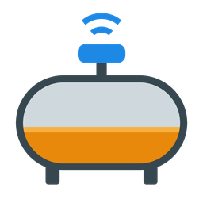

# Smart Oil Gauge for Home Assistant



A custom integration for the [Smart Oil Gauge](https://www.smartoilgauge.com)
heating-oil tank monitor. It reads the same data as the web app at
app.smartoilgauge.com: tank level, usage rate, days until the tank runs low,
usage history, deliveries and sensor health. Each tank on the account
becomes a device in Home Assistant.

Smart Oil Gauge doesn't offer an API for owners, so the integration logs in
the way the website does and reads the website's own data calls. If the
company changes the site, the integration may need an update.

> [!WARNING]
> **Unofficial. Not affiliated with Smart Oil Gauge. Use at your own risk.**
> See the [disclaimer](#disclaimer) below.

## Install

1. In HACS, open the menu → **Custom repositories**, add
   `https://github.com/kkrankall/smartoil-gauge` as an **Integration**.
2. Download **Smart Oil Gauge** and restart Home Assistant.
3. Go to **Settings → Devices & services → Add integration → Smart Oil Gauge**
   and log in with your app.smartoilgauge.com username (or email) and password.

## Entities

For each tank:

| Entity | Notes |
|---|---|
| Gallons | Current reading, as shown on the website. |
| Level | Percent of the tank's nominal capacity. |
| Usage rate | Gallons per day: the website's rolling average over the past week or two. |
| Days to low level | Days until the level reaches the low-level alert set on the website (1/4 tank by default). |
| Days to 1/8 tank | Days until 1/8 of a tank. |
| Gallons to fill | Room left up to the tank's fillable capacity. |
| Used last 7 / 30 / 365 days | Gallons burned in each period, net of deliveries, as the website's graph reports them. |
| Last fill, Last fill amount | The most recent delivery, found as a jump of at least 20 gallons (or 10% of the tank) between readings. |
| Temperature | Temperature at the gauge, in °F. |
| Last reading | When the gauge last uploaded a reading (about hourly). |
| Low level | On while the level is below the low-level alert. |
| Sensor offline | On after 96 hours without a reading, when the website also flags the gauge offline. |
| Battery, Sensor status, Capacity, Fillable capacity, Low level alert | Diagnostic. |

The days-to estimates follow the website's own rules: no estimate while the
gauge is offline or while usage is under 0.2 gallons a day.

## How it works

- Polls every 30 minutes. The gauge itself uploads about once an hour.
- The login uses the website's session cookie. The cookie is saved, so a
  Home Assistant restart doesn't log in again. The integration only sends
  your password when the site says the session has expired.
- If the password stops working, Home Assistant shows a **Reauthenticate**
  prompt instead of retrying, so the integration can't lock your account.
- **Download diagnostics** on the integration gives the raw tank data, with
  your username, ZIP code, sensor ID and dealer link removed.

## Development

```
pip install pytest-homeassistant-custom-component
pytest
```

The tests run the client against a fake site that mirrors the real login
form and data calls, and check the values against captured responses.

The icon is original artwork drawn by `scripts/draw_icon.py`
(`python scripts/draw_icon.py custom_components/smartoil_gauge/brand` and again
with `dark` as a second argument; needs Pillow). Home Assistant shows it from
the integration's `brand` folder; older versions show a placeholder instead.

## Disclaimer

This is an independent, unofficial project. It is not affiliated with,
endorsed by, or supported by Smart Oil Gauge, Connected Consumer Fuel,
FuelSnap, or any fuel dealer. "Smart Oil Gauge" and related names are
trademarks of their owners and are used here only to say what the
integration works with. Please don't contact Smart Oil Gauge support about
this integration; open an issue here instead.

Use it at your own risk:

- It relies on the website's internal requests, which aren't a public API.
  They can change or stop working at any time without notice.
- Check Smart Oil Gauge's terms of service and decide for yourself whether
  automated access to your account is acceptable.
- Your Smart Oil Gauge username and password are stored in your Home
  Assistant configuration, like other integrations' credentials.
- Readings, estimates, delivery detection and alerts can be wrong, late or
  missing. Don't rely on this integration alone to decide when to order oil.
  Keep an eye on your tank and on the official app, especially in winter.

The software is provided "as is", without warranty of any kind, as set out
in the [MIT License](LICENSE). The authors are not liable for any damages or
losses from using it, including running out of fuel, frozen pipes, missed
deliveries, or problems with your Smart Oil Gauge account.
